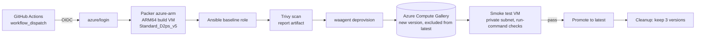

# azure-arm64-image-pipeline

Automated build of a hardened **Ubuntu 24.04 ARM64** image for Azure:
**Packer + Ansible → Azure Compute Gallery**, driven by **GitHub Actions**
with OIDC (no stored secrets), smoke-tested on a real ARM64 VM before release.



## What it does

| Stage | Tool | Details |
|---|---|---|
| Infrastructure | Terraform | Resource groups, Compute Gallery, ARM64 Gen2 image definition, smoke-test network, Entra ID app with GitHub OIDC federated credential, least-privilege role assignments, Azure Policy for approved images |
| Build | Packer (`azure-arm`) | Ubuntu 24.04 `server-arm64` marketplace image on an Ampere Altra VM, published straight to the gallery |
| Configuration | Ansible | `baseline` role: package updates, unattended security upgrades, SSH hardening, kernel `sysctl` hardening, auditd rules, chrony, image metadata in `/etc/image-release` |
| Vulnerability check | Trivy | File-system scan of the finished image; report uploaded as a workflow artifact; optional gate on fixable CRITICAL findings |
| Validation | Azure CLI | Boots a VM from the new version (no public IP), runs checks with `az vm run-command`, then deletes the VM |
| Controlled rollout | Azure CLI | New versions are published with `excludeFromLatest=true` and promoted only after the smoke test passes |
| Lifecycle | Bash + Azure CLI | Keeps the three newest promoted versions and removes failed ones |
| Governance | Azure Policy | VMs in the workloads resource group must use the approved gallery (Audit by default, Deny optional) |

Versions follow `YYYY.MMDD.RUN` (for example `2026.1105.7`), which sorts correctly in the gallery.

## Continuous integration

`.github/workflows/ci.yml` runs on every push and pull request, without Azure access:

- `packer fmt` / `packer validate`, `terraform fmt` / `terraform validate`
- `ansible-lint` (production profile) and `shellcheck`
- the Ansible role applied to a **GitHub-hosted ARM64 runner** (`ubuntu-24.04-arm`), followed by a verification playbook and an idempotence check (second run must report `changed=0`)

## Setup

Requirements: an Azure subscription where you are Owner (use a personal or
sandbox subscription, not a production or employer one), Azure CLI, Terraform >= 1.6,
and vCPU quota for the `Standard DPSv5 Family` in the chosen region.

1. **Create the Azure resources**

   ```sh
   az login
   cd terraform
   cp terraform.tfvars.example terraform.tfvars   # set subscription_id and github_repository
   terraform init
   terraform apply
   ```

2. **Store the outputs as GitHub repository variables** (Settings → Secrets and variables → Actions → Variables).
   With the GitHub CLI:

   ```sh
   terraform output -json github_variables \
     | jq -r 'to_entries[] | "\(.key)\t\(.value)"' \
     | while IFS=$'\t' read -r k v; do gh variable set "$k" --body "$v"; done
   ```

   These are identifiers, not secrets: authentication uses OIDC federation, so no
   client secret exists anywhere.

3. **Run the pipeline**: Actions → *Build image* → *Run workflow*.
   A full run takes roughly 30–40 minutes.

4. **Use the image**

   ```sh
   az vm create -g rg-workloads -n demo --size Standard_D2ps_v5 \
     --image "$(az sig image-definition show -g rg-image-gallery -r gal_arm64_images \
                 -i ubuntu-24.04-arm64-baseline --query id -o tsv)" \
     --generate-ssh-keys
   ```

## Costs and clean-up

Builds and smoke tests use short-lived ARM64 VMs that are deleted automatically.
The gallery keeps up to three image versions. Set a budget alert in Azure Cost
Management, and remove everything with `terraform destroy` when you are done.
The weekly scheduled rebuild in `build-image.yml` is commented out on purpose.

## Run the role locally

On an Ubuntu 22.04/24.04 test machine:

```sh
cd ansible
ansible-playbook -i localhost, -c local playbook.yml -e baseline_upgrade=false -e baseline_require_arm64=false
ansible-playbook -i localhost, -c local verify.yml
```

## Layout

```
.github/workflows/   ci.yml (lint, validate, ARM64 role test), build-image.yml (build, test, promote, cleanup)
terraform/           gallery, image definition, network, OIDC identity, RBAC, Azure Policy
packer/              azure-arm source, build steps, variables
ansible/             baseline role, playbook, verification playbook
scripts/             Trivy scan, smoke test, in-VM checks, version cleanup
```

## Possible next steps

- AlmaLinux 9 ARM64 variant (RPM-based) from the same role
- Microsoft Defender for Cloud / Defender Vulnerability Management integration
- Replication to additional regions and ZRS storage for production
- Grafana/Loki agent baked into the image for centralized logs
